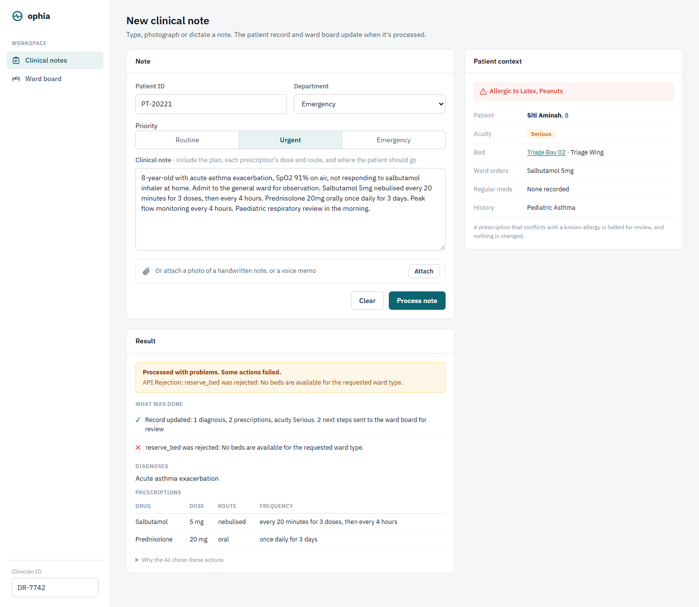
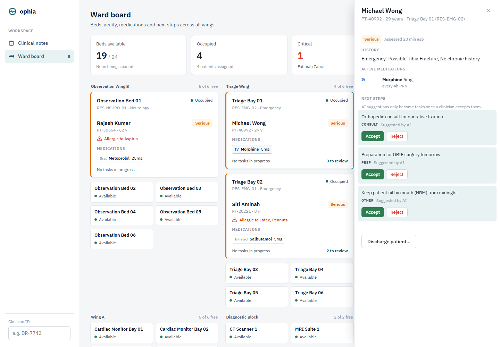

# Ophia: AI-Powered Clinical Workflow Intelligence
**UM Hackathon 2026 — Domain 1: AI Systems & Agentic Workflow Automation**

OPHIA is a hackathon prototype of an AI clinical workflow orchestrator. It takes an unstructured clinical note (typed, photographed or dictated), uses an LLM to extract diagnoses and prescriptions, and turns them into hospital actions such as updating the patient record, reserving a bed or scheduling a follow-up. It's a demo and is not meant for clinical use.

---

## 🎥 Project Demo & Presentation
> **[WATCH THE SUBMISSION VIDEO HERE](https://drive.google.com/drive/folders/1QwInfCI_nnIr09jofypu5DqwKQUyDCa6?usp=sharing)**
> 
> *This folder contains our formal pitching presentation and the high-fidelity demonstration of the OPHIA orchestrator in action.*

---

## 🏗️ Architecture
OPHIA runs as four small services:

1.  **Ingestion Engine (Port 5000):** Flask-based gateway for multimodal data (OCR/Audio ingestion).
2.  **The Orchestrator (Port 8000):** FastAPI "Brain" powered by **Groq (`openai/gpt-oss-120b`)** for clinical reasoning. Image notes are read with `qwen/qwen3.8-27b` and audio with `whisper-large-v3`.
3.  **Mock EMR API (Port 3001):** The execution layer that routes AI commands to **Supabase** persistence.
4.  **Frontend (Port 5500):** Two vanilla JS pages, no build step. The **clinical notes** page submits notes; the **ward board** shows every bed live.

---

## 📄 Official Deliverables (PDF)
The following documents are located in the root directory for review:
* **[System Architecture Document (SAD)](./SAD_Ophia.pdf)** — Technical diagrams and mesh logic.
* **[Product Requirement Document (PRD)](./PRD_Ophia.pdf)** — Problem analysis and feature roadmap.
* **[Quality Assurance Document (QATD)](./QATD_Ophia.pdf)** — Safety protocols and audit trail integrity.
* **[Pitching Deck](./Ophia.pdf)** — Our strategy and market vision.

---

## 🚀 Quick Start Guide

### Prerequisites
* Python 3.12
* A [Groq API key](https://console.groq.com/keys)
* A Supabase project (the free tier is fine)

### 1. Set up the database
In your Supabase project's SQL editor, run [`db/schema.sql`](./db/schema.sql) to create the tables, then [`db/seed.sql`](./db/seed.sql) for the demo patients and a 24-bed ward (all fictional).

If your database was created from an older version of `schema.sql`, apply the files in [`db/migrations/`](./db/migrations/) in order instead. Each one has a matching `.down.sql` rollback.

### 2. Install dependencies
All three services share one `requirements.txt`:

```bash
python -m venv .venv
.venv\Scripts\activate        # macOS/Linux: source .venv/bin/activate
pip install -r requirements.txt
```

### 3. Environment setup
Create a `.env` file in the repo root. Every service reads this same file:

```env
# Groq API key (ZAI_API_KEY is still accepted as the old name)
GROQ_API_KEY=your_groq_key_here

# Where the orchestrator sends hospital actions (the Mock EMR API)
MOCK_API_BASE_URL=http://127.0.0.1:3001

# Supabase project URL and secret key (Project Settings -> API Keys).
# Server-side only: every table has row-level security, so the publishable key
# can't read or write anything and is refused.
SUPABASE_URL=your_supabase_url
SUPABASE_SECRET_KEY=your_supabase_secret_key

# Optional: override the Groq models if Groq retires one (see https://console.groq.com/docs/deprecations)
# GROQ_CHAT_MODEL=openai/gpt-oss-120b
# GROQ_VISION_MODEL=qwen/qwen3.8-27b

# Optional: set to 1 to enable the Flask debugger locally (never on a public URL)
# FLASK_DEBUG=1
```

### 4. Launch
Run each service from the repo root in its own terminal:

| Terminal | Service | Command |
|---|---|---|
| 1 | Mock EMR API (3001) | `python server.py` |
| 2 | Orchestrator (8000) | `uvicorn main:app --app-dir Ophia --reload --port 8000` |
| 3 | Ingestion (5000) | `python ingestion/ingestion.py` |
| 4 | Frontend (5500) | `python -m http.server 5500 --directory frontend`, then open http://localhost:5500 (notes) or http://localhost:5500/board.html (ward board) |

Interactive API docs for the orchestrator are at http://localhost:8000/docs.

---

## 📝 Clinical Notes


`index.html` is where a clinician records a note: typed, or as a photo or voice memo.
* **Patient context:** as you type a patient ID, their allergies, acuity, current bed, ward medication orders and history load alongside the form, so an allergy is visible *before* you prescribe.
* **Photos and voice memos:** attach a photo of a handwritten note (read with a vision model) or a voice memo (transcribed with Whisper). Anything typed alongside is kept and combined with it. Try [`docs/samples/handwritten_note.jpg`](./docs/samples/handwritten_note.jpg) for `PT-40992`, or [`docs/samples/voice_memo.wav`](./docs/samples/voice_memo.wav) for `PT-10934`. The memo prescribes amoxicillin to a patient with a penicillin allergy, so it's halted for review.
* **Clear results:** after processing you see exactly what happened: the record updated, the bed reserved (or why not), the follow-ups booked, how many next steps went to the ward board, the extracted prescriptions, and the AI's reasoning. Partial failures and safety halts are spelled out rather than hidden.

---

## 🛏️ Ward Board


`board.html` shows all 24 beds across four wards, plus the scanners, and refreshes every 5 seconds. Everything on it comes from processed notes; nothing is hardcoded.
* **Bed cards:** status (available / occupied / being cleaned / maintenance), patient, **acuity** (critical / serious / stable, also shown by the card's colour), allergy warnings, active medications with **IV lines first**, accepted next steps, and how many AI suggestions are waiting.
* **Patient panel:** click a card (or link to `board.html#bed=RES-ICU-01`) for history, all active medications and open tasks.
* **Human in the loop:** AI-suggested next steps must be **accepted or rejected by a clinician** (enter your clinician ID in the sidebar; it's shared with the notes page). Accepted tasks can be marked done. Each decision records who made it and when, and two clinicians can't both decide the same suggestion.
* **Waiting for a bed:** when a note admits a patient and no suitable bed is free, the admission joins a waiting list instead of failing. The list sits above the wings, sickest first, then longest waiting. **Assign bed** gives the best free bed once one exists (transfers included), and **Remove** takes a patient off the list. Waiting patients open in the same drawer, so their medications and AI suggestions stay reviewable. The database allows only one open request per patient.
* **Stopping medications:** a note that explicitly says to stop a drug ("Stop metoprolol") stops it. A stop the AI only infers ("deteriorating *despite* doxycycline, start meropenem") becomes a proposal, **Stop it / Keep it**, for a clinician to decide. The server checks the doctor's own words, so if the AI calls a stop explicit but the note never says so, it's downgraded to a proposal. Clinicians can also stop any medication from the drawer. Every stop records who stopped it and why.
* **Discharge:** *Discharge patient* in the drawer (with a confirm step) frees the bed for cleaning, marks the patient's ward medications completed and cancels open tasks. Nothing is deleted, and the clinician ID is recorded.
* **Bed turnover:** after a discharge or transfer the bed goes to *being cleaned*; **Mark clean** makes it available again. Free beds show as compact tiles so a full ward stays scannable.
* **Bed allocation:** admissions get a bed in an observation area when the note asks for observation, otherwise in the note's own department (Emergency → triage, Cardiology → cardiac bays). The database rejects an "occupied" bed with no patient in it.
* **Security:** the board talks only to the Mock EMR API (`GET /api/ward-board`, `POST /api/tasks/<id>/decision`, `POST /api/beds/<id>/mark-clean`). The browser never gets a Supabase key.

---

## 🧪 The "Rajesh Kumar" Demo Scenario
Enter patient ID `PT-30554` and the following note into the dashboard:

"Patient Rajesh Kumar (ID: PT-30554) presents to the emergency department complaining of sudden onset palpitations, shortness of breath, and mild chest tightness that began 2 hours ago. Vitals show an irregular heart rate of 138 bpm and blood pressure of 145/90. Preliminary ECG indicates acute Atrial Fibrillation with rapid ventricular response. Plan: Admit to the observation ward. Initiate continuous cardiac monitoring (telemetry) immediately. Prescribed Metoprolol 25mg orally to control heart rate. Monitor for drug interactions."

The **OPHIA** Execution Loop:

**READ**: The ingestion service passes the note (or the text extracted from an image or audio file) to the orchestrator.

**REASON**: The orchestrator loads the patient's allergies and active prescriptions from Supabase and asks the LLM to decide which actions the note calls for.

**ACT**: The LLM's chosen actions are executed against the Mock EMR API. For this note, expect `update_record` for the Metoprolol prescription and `reserve_bed` for the requested ward.

**PERSIST**: In Supabase, a new row appears in `clinical_notes` and the reserved bed in `hospital_resources` flips to `occupied`.

Every run reserves a bed, so free them again between demos:

```bash
python tools/reset_demo.py                 # free the beds (add --dry-run to preview)
python tools/reset_demo.py --clear-board   # also clear medications, tasks and acuity
```

---

## ✅ Testing
```bash
pip install -r requirements-dev.txt
pytest
```
The tests cover all three services with Supabase, Groq and the other services mocked, so they need no API keys. They run on every push and pull request via GitHub Actions.

The LLM itself is checked separately by a **clinical safety eval**. It runs fixed notes through the real prompt and model and checks the decisions: halt on allergy conflicts, ICU vs observation beds, no bed for outpatients. It calls Groq, so run it by hand after changing the prompt or model:

```bash
python evals/run_safety_eval.py --runs 3
```

---

## 🛡️ Safety Behaviour (and Current Limits)
* **Allergy checks (deterministic):** every prescription is checked by a rule table ([`Ophia/allergy_rules.py`](./Ophia/allergy_rules.py)) of drug classes and cross-reactivities, so the same inputs always give the same outcome.
  * **Block:** the drug is the allergen or in its class (aspirin allergy + aspirin, penicillin allergy + amoxicillin). The note is halted before anything runs, even if the LLM missed it, and the record API refuses it too.
  * **Warn:** cross-reactivity is possible (penicillin allergy + meropenem or ceftriaxone, ibuprofen allergy + naproxen). The note goes ahead, the warning is shown on the result, and it stays on that medication on the ward board.
  * The LLM still sees the allergies and halts on direct conflicts as a second layer, and catches drugs the table doesn't know. The rule table is a demonstration set, not a complete clinical knowledge base.
* **Halting:** If the LLM halts, the request returns `halted_for_clarification` and nothing is executed. If some actions succeed and others are rejected or fail (e.g. the record is saved but no bed is free), the request returns `partial_success`. The dashboard then lists exactly which actions failed; earlier actions aren't rolled back.
* **Audit trail:** Each processed note is saved to `clinical_notes` with the original text, the extracted diagnoses and prescriptions, and the LLM's reasoning for its actions.
* **Ward board data:** Prescriptions become `medication_orders` (routes normalised, e.g. "orally" → `oral`, "IV drip" → `iv`), the patient's acuity is updated, and next steps become `care_tasks` with status `suggested`. AI suggestions aren't real tasks until a clinician accepts them. Repeated notes don't duplicate active medications, open tasks or beds. Asking for a different kind of bed is a transfer, and the old bed is released for cleaning.
* **Rate limits:** On Groq's free tier (8,000 tokens per minute) the orchestrator handles about five notes a minute. Beyond that, requests halt with an `AI Gateway Error` and can simply be retried.
* **Database access:** every table has row-level security with no policies, so only the server-side secret key can use the database. The publishable key sees no rows and can't write. The browser never talks to Supabase directly.
* **No silent allergy-check bypass:** if the patient's record can't be checked (missing or wrong key, database down), the note is halted rather than processed without an allergy check. A genuinely new patient with no record is processed normally.
* **No authentication on the APIs:** the three local services have no login and accept requests from any origin. Run them locally only.

---

Developed for the UM Hackathon 2026. "AI-First, Patient-Always."
